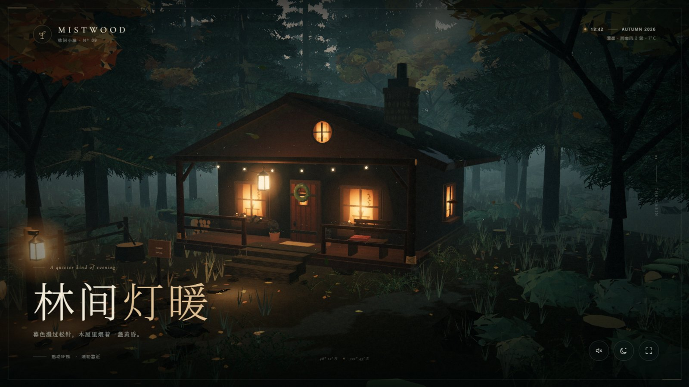
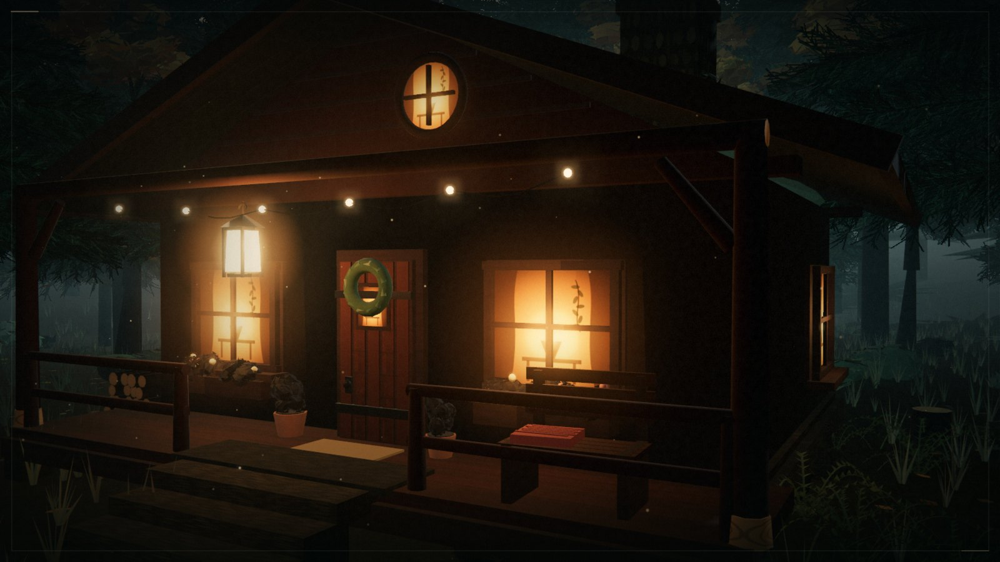
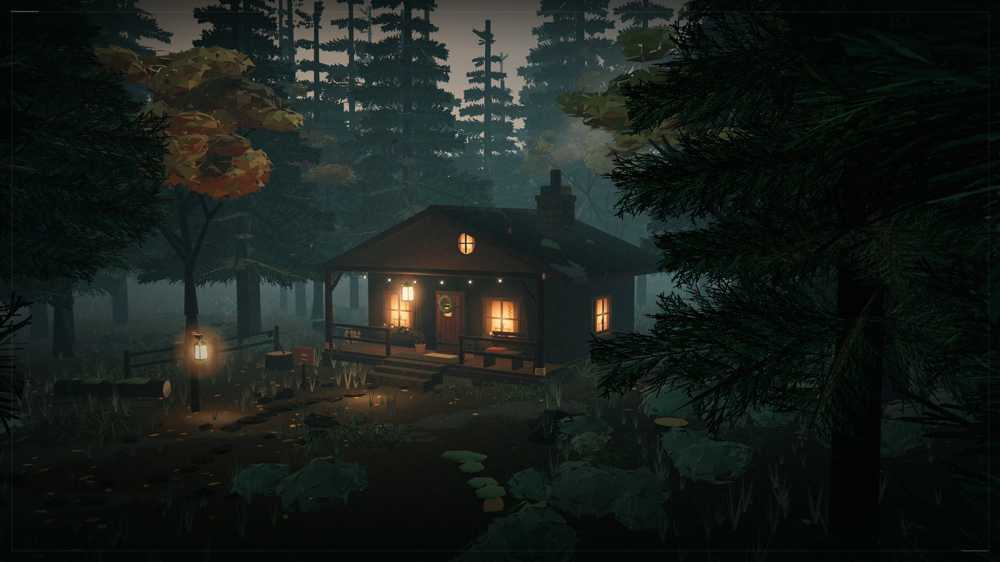
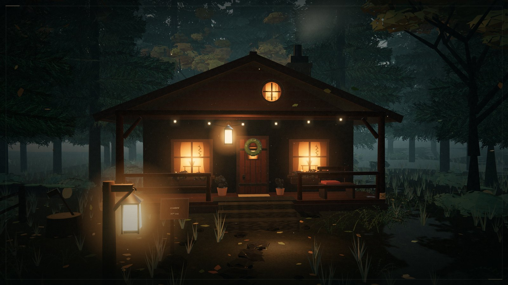
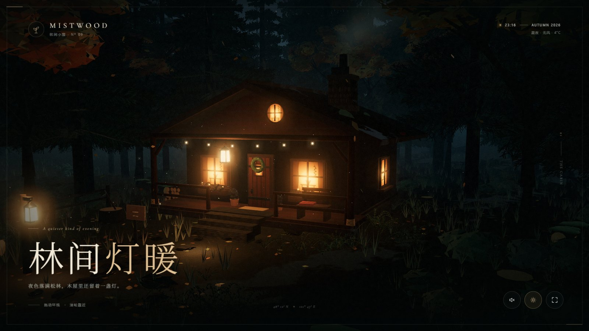
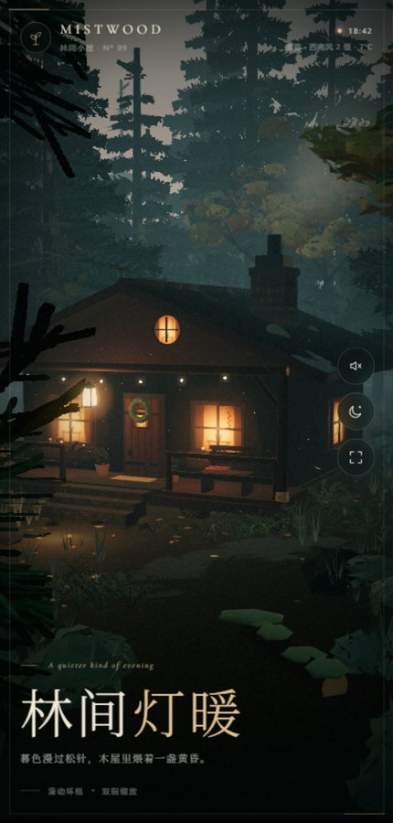

# 林间灯暖 · Mistwood Cabin

> 一个纯程序化的 Three.js 森林木屋场景 —— 秋日蓝调时刻、松林薄雾，以及门廊上那盏一直亮着的灯。

没有外部模型、贴图或 HDR 素材。木屋、松林、地被、材质、天空与炊烟全部由代码在浏览器里生成，打开即可运行，无需构建。



*暮色 · 主场景 —— 蓝调时刻的低角度光线从林间斜切进来，冷灰蓝的雾与门廊的暖橙形成整个画面的色彩支点。右侧的秋树、左侧的灯笼与屋脊上的圆窗一起把视线收拢到木屋中央。*

## 视觉效果

### 门廊 · 暖光细节

凑近看时，原木墙体的接缝、窗内的窗帘与台灯剪影、花箱里的秋植、门上的花环、长椅上的毛毯，以及沿着屋檐垂下的灯串，构成了「有人住在这里」的叙事细节。



### 森林 · 远景

镜头拉远后，程序化松林的层次、被雾吞没的纵深和蜿蜒入林的石径成为主角。树冠的针叶是逐片生成的卡片，在风里以不同相位轻轻摆动。



### 小径 · 迎向灯火

从林间小径回望，暖光顺着地面铺开，萤火、飘落的秋叶与远处炊烟让静止的场景保持呼吸感。



### 深夜 · 星夜模式

点击右下角的月亮按钮，天色会平滑过渡到深夜：星星浮现、雾气变冷、萤火虫更亮，窗内的灯光成为画面唯一的暖色。



### 手机竖屏

竖屏下镜头会自动后撤并放宽视野，界面元素重新排布，木屋仍保持完整的构图。



## 运行

无需安装依赖，启动任意静态服务器即可：

```bash
python -m http.server 4173
```

然后打开 [http://127.0.0.1:4173/](http://127.0.0.1:4173/)。需要支持 WebGL 2 的浏览器（推荐 Chrome / Edge / Safari 最新版）。

## 交互

| 操作 | 效果 |
| --- | --- |
| 拖动 / 单指滑动 | 环视木屋与森林 |
| 滚轮 / 双指捏合 | 拉近、拉远 |
| 空闲约 20 秒 | 镜头开始极缓慢地漂移 |
| 左下角声音按钮 | 开启程序化环境声（风声、虫鸣、炉火轻响） |
| 月亮按钮 | 在黄昏与深夜之间切换 |
| 全屏按钮 | 进入 / 退出全屏 |

进入场景时会有一段很慢的镜头推近；一旦拖动画面，控制权立刻交给用户。

## 实现要点

- **原生 ES Modules + 本地内置的 Three.js r160**，无打包、无依赖安装。
- **程序化材质**：树皮、原木、木板、石墙、屋瓦、泥土地面、窗内暖光、灯笼光晕全部由 Canvas 实时绘制。
- **程序化植被**：松树的针叶卡片、秋树的叶簇、蕨类、草叶、落叶与蘑菇均按几何或实例化方式生成。
- **氛围系统**：自制天空 Shader（云层、星空、月亮）、指数雾、地面雾片、炊烟、萤火虫、飘落秋叶与浮尘。
- **电影感后处理**：ACES 色调映射 + Bloom + 自定义调色（冷阴影 / 暖高光、暗角、轻微色散、胶片颗粒）。
- **性能**：静态木屋与地面细节按材质合并，绘制调用由约 600 次降至约 160 次；阴影只烘焙一次；实例化渲染承载上万株植被。
- **响应式**：横屏与竖屏分别校准了机位、视场角与 UI 布局。
- **音效**：Web Audio 实时合成，无音频文件，默认关闭。

## 项目结构

```
index.html            页面结构、加载动画与界面
styles.css            排版、控件与响应式布局
src/main.js           渲染循环、相机、后处理与交互
src/cabin.js          木屋建模（墙体、屋顶、门窗、门廊、细节陈设）
src/environment.js    天空、地形、小径、雾、光照与昼夜过渡
src/forest.js         松林、秋树、地被、炊烟、萤火与落叶
src/audio.js          程序化环境声
src/utils.js          噪声、程序化贴图与几何工具
vendor/three/         本地内置的 Three.js r160
docs/images/          README 效果图
screenshots/          原始 PNG 截图
```

## 说明

界面字体通过 Google Fonts 加载，离线时会回退到系统衬线字体，不影响场景渲染。Three.js 以 MIT 许可证随项目分发。
