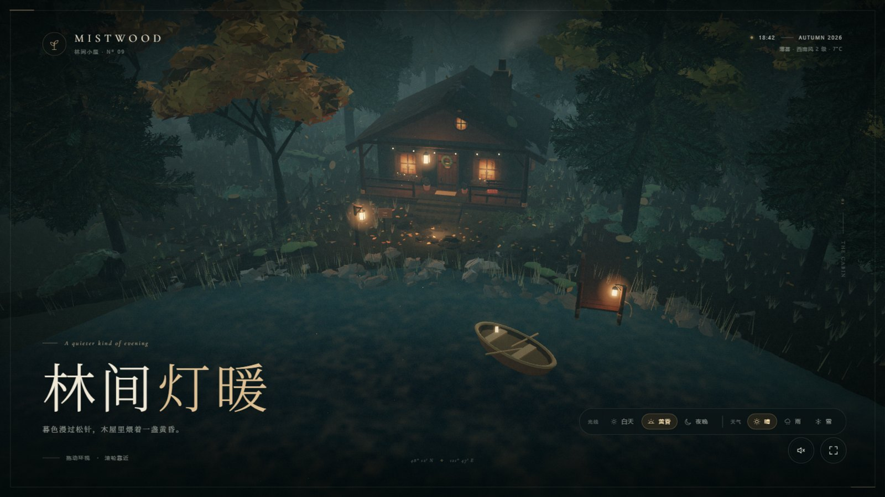
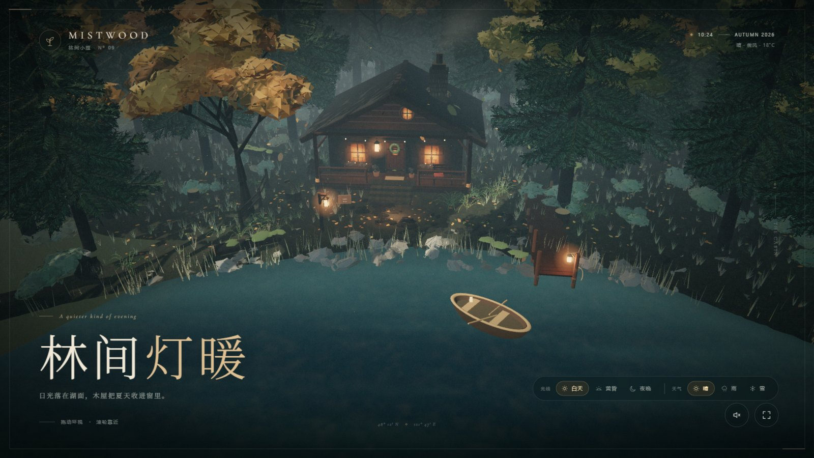
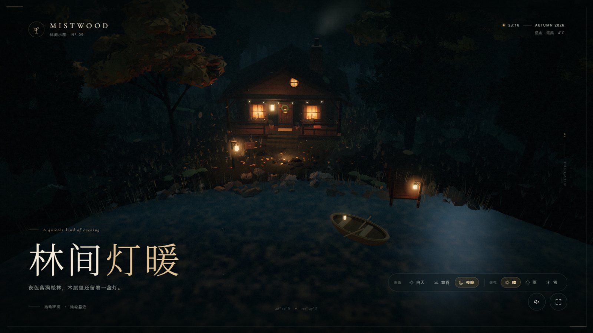
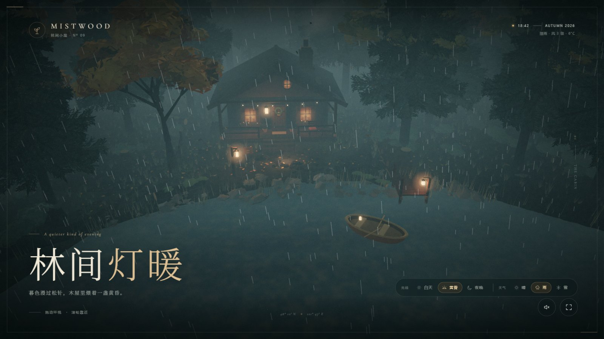
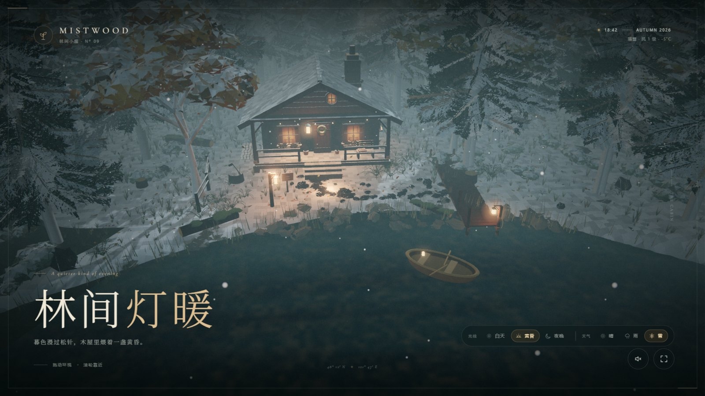

# 林间灯暖 · Mistwood Cabin

> 一个纯程序化的 Three.js 湖畔木屋场景 —— 森林深处、薄雾、一盏灯，以及可自由切换的光线与天气。

没有外部模型、贴图或 HDR 素材。木屋、湖泊、码头、松林、地被、材质、天空与炊烟全部由代码在浏览器里生成，打开即可运行，无需构建。（场景准备和渲染会在载入时进行 一开始会有略微卡顿感）



## 场景概览（下面的图片已经是旧版了）

镜头位于湖畔的高处，俯瞰木屋、湖面与木码头。湖面有自己的着色器：天空反射、菲涅耳边缘、日月光带、雨滴涟漪与岸边的暖灯倒影。左侧一条石径从森林深处走到码头，右侧是林间空地。

- **湖泊**：椭圆湖盆，岸线经过地形雕刻，水面延伸到岸下，避免出现硬边。
- **木质码头**：逐块木板的桥面、桥桩、斜撑、系船绳与一盏暖灯，尽头停着一艘小船。
- **木屋**：原木墙体、石砌烟囱、瓦片屋顶、门廊、立柱、栏杆、花窗、花环与长椅。
- **森林**：程序化松林与秋树，针叶卡片随风摆动，林下有蕨类、草丛、蘑菇、倒木与落叶。

## 光线：白天 / 黄昏 / 夜晚

右下角面板可随时切换，所有参数会在数秒内平滑过渡，而不是硬切。

| 白天 | 黄昏 |
| --- | --- |
|  |  |

| 夜晚 |
| --- |
|  |

切换会同时改变：天空渐变、太阳/月亮位置与色温、半球光、雾色与浓度、曝光、窗光强度、Bloom 强度，以及水面的反射色调。白天窗内灯光自动变暗，夜晚则成为画面唯一暖色。

## 天气：晴 / 雨 / 雪

| 雨 | 雪 |
| --- | --- |
|  |  |

- **晴**：清透的空气、轻微薄雾与清晰的水面反射。
- **雨**：细雨朦胧 —— 密集但很淡的短雨丝、加浓的雾、柔化的远景与水面涟漪，整体像一层薄纱而不是暴雨。
- **雪**：飘雪粒子、地面积雪（基于世界坐标与表面法线的着色器补丁）、冷调雾气；屋顶、岸石与地面都会自然积白。

光线与天气可以任意组合，共 9 种状态。

## 运行

无需安装依赖，启动任意静态服务器即可：

```bash
python -m http.server 4173
```

然后打开 [http://127.0.0.1:4173/](http://127.0.0.1:4173/)。需要支持 WebGL 2 的浏览器（推荐 Chrome / Edge / Safari 最新版）。

## 交互

| 操作 | 效果 |
| --- | --- |
| 拖动 / 单指滑动 | 环视木屋、湖面与码头 |
| 滚轮 / 双指捏合 | 拉近、拉远 |
| 光线：白天 / 黄昏 / 夜晚 | 平滑切换时段 |
| 天气：晴 / 雨 / 雪 | 平滑切换天气 |
| 左下角声音按钮 | 程序化环境声（风、虫鸣、炉火） |
| 全屏按钮 | 进入 / 退出全屏 |

进入场景时镜头会从更高更远处缓慢推近；一旦拖动画面，控制权立刻交给用户。空闲约 20 秒后镜头开始极缓慢地漂移。

## 实现要点

- **原生 ES Modules + 本地内置的 Three.js r160**，无打包、无依赖安装。
- **程序化材质**：树皮、原木、木板、石墙、屋瓦、泥土地面、窗内暖光、灯笼光晕全部由 Canvas 实时绘制。
- **湖泊着色器**：多层噪声法线、基于平坦反射的天空采样（避免条带）、菲涅耳、日光高光、雨滴涟漪、暖灯闪烁倒影、岸边暗边与水面风纹，并与场景雾融合。
- **湖岸**：一整圈沿椭圆岸线排布的石块（明暗两种石材），在码头处留出缺口。
- **天气粒子**：细雨为 GPU 动画的短线，雪为跟随相机的点精灵，两者都在着色器内完成运动与淡出。
- **积雪**：通过 `onBeforeCompile` 给标准材质打补丁，按世界法线朝上程度混入雪色；补丁是幂等的，避免重复注入导致着色器编译失败。
- **屋顶与山墙**：两者共用同一条坡度线，山墙向上嵌入屋顶板，烟囱再以石质围裙遮住交界，因此不会出现缝隙。
- **性能**：静态木屋与地面细节按材质合并，绘制调用由约 600 次降至约 160 次；阴影只烘焙一次；实例化渲染承载上万株植被；Bloom 分辨率与设备像素对齐。
- **响应式**：横屏与竖屏分别校准了机位、视场角与 UI 布局。
- **音效**：Web Audio 实时合成，无音频文件，默认关闭。

## 项目结构

```
index.html            页面结构、加载动画与界面
styles.css            排版、控件与响应式布局
src/main.js           渲染循环、相机、后处理与交互
src/cabin.js          木屋建模（墙体、屋顶、门窗、门廊、细节陈设）
src/lake.js           湖泊水面、码头、小船、芦苇与岸石
src/weather.js        雨与雪的粒子系统
src/environment.js    天空、地形、小径、雾、光照与时段预设
src/forest.js         松林、秋树、地被、炊烟、萤火与落叶
src/audio.js          程序化环境声
src/utils.js          噪声、程序化贴图、几何与积雪工具
vendor/three/         本地内置的 Three.js r160
docs/images/          README 效果图
```

## 说明

界面字体通过 Google Fonts 加载，离线时会回退到系统衬线字体，不影响场景渲染。Three.js 以 MIT 许可证随项目分发。
